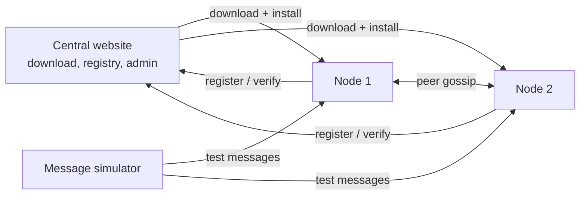

# PeerOne

PeerOne is peer-to-peer crypto exchange network software. Anyone can download and install a **node** (a private server that runs on their own computer). Nodes share marketplace data with each other directly, decide what to process first using proof of work and fees, and keep a signed, tamper-evident history of every update.

> **Status:** under active development. Parts of this repo are working prototypes and test tools, not finished production code.

---

## Contents

- [How it fits together](#how-it-fits-together)
- [Repository layout](#repository-layout)
- [Requirements](#requirements)
- [Quick start](#quick-start)
  - [Install a node](#install-a-node)
  - [Run the full development setup](#run-the-full-development-setup)
  - [Two-node peer demo](#two-node-peer-demo)
- [Components in depth](#components-in-depth)
  - [Central website and node registry](#central-website-and-node-registry)
  - [Node server](#node-server)
  - [Installation verification](#installation-verification)
  - [Peer gossip](#peer-gossip)
  - [Priority queue](#priority-queue)
  - [Lineages](#lineages)
  - [Message simulator](#message-simulator)
  - [Update tree and signed log](#update-tree-and-signed-log)
- [Ports](#ports)
- [Security](#security)
- [Roadmap](#roadmap)
- [License](#license)

---

## How it fits together



- The **central website** is where people download a node. It keeps a registry of installed nodes and has an owner/admin dashboard. It does **not** control the nodes. The network has no main server privilege.
- Each **node** runs on its own computer with its own database. Nodes don't log in to each other and can't read each other's files.
- Nodes keep each other up to date with **peer gossip**: "do you have information I don't have?"
- Incoming peer messages go into a **priority queue** ordered by **proof of work x fee**.
- The **message simulator** generates random lineage-to-lineage traffic to test that nodes stay in sync.
- The **update tree** is the system's in-memory history, saved to an append-only log where every update is hash-chained and signed with Ed25519.

---

## Repository layout

| Path | What it is |
|---|---|
| `index.php`, `install.php`, `install-dev.php`, `download.php`, `download-dev.php` | Central website pages: homepage, install instructions, and the two download buttons |
| `admin/` | Owner/admin login and dashboard (lists registered nodes, verifies installations) |
| `api/` | Central API: `register-node.php`, `checkin.php`, `verify-installation.php` |
| `includes/` | Shared central code: config, database connection, auth, install verification, `LineageStore.php` |
| `database/` | Central database schemas, setup scripts, and lineage scripts |
| `server-package/` | The **node** people download with the "Install Server" button |
| `swopblock-dev/` | The **development package** downloaded with the "Install Development Tools" button: a local central, a local client node, and helper scripts |
| `simulator/` | Message simulator that sends test traffic to nodes |
| `tree/` | Update tree, append-only signed log, and their tests |
| `docs/` | Design documents (for example, how trading bids and asks will work) |
| `LICENSE` | Swopblock Network License (SNL 1.0) |

> `download.php` zips the `server-package/` folder and `download-dev.php` zips the `swopblock-dev/` folder **by name**. Renaming or moving those folders breaks the download buttons.

---

## Requirements

**To install a node:** nothing beforehand. On Windows, `install.bat` checks for PHP. If it's missing, it offers to download the official PHP binary from php.net, **verifies its SHA-256 hash**, and installs it for the node.

**To develop:**

- PHP 8+ with these extensions enabled: `pdo_sqlite`, `sqlite3`, `mbstring`, `openssl`, and `sodium` (sodium is required for signing in `tree/`)
- For the 1,000,000-lineage test database: MySQL or MariaDB, and PHP's `pdo_mysql` extension
- Git

To turn on an extension, open your `php.ini`, find the line (for example `;extension=sodium`), and delete the `;` at the start. Check it with:

```powershell
php -r "echo function_exists('sodium_crypto_sign_keypair') ? 'sodium ON' : 'sodium OFF';"
```

---

## Quick start

### Install a node

1. On the central website, click **Install Server** and download `crypto-marketplace-server.zip`.
2. Unzip the **whole** package.
3. Double-click **`install.bat`**. No PowerShell typing is needed. If PHP is missing, press Enter or type `Y` when asked.
4. Start the node from `%USERPROFILE%\CryptoMarketplaceServer` with **`start-server.bat`**.
5. Open <http://localhost:8080>.
6. To register the node with central, run `register-with-central.ps1` from the package folder. The node then appears on the admin dashboard.

### Run the full development setup

Everything runs from the one unzipped `swopblock-dev` folder, with no XAMPP needed.

1. Double-click **`install-dev.bat`** (only once).
2. Double-click **`start-central.bat`**. Central runs at <http://127.0.0.1:8081>.
3. Double-click **`start-client.bat`** in a second window. The client node runs at <http://127.0.0.1:8080>, and a background gossip window opens for it.
4. Double-click **`register-client.bat`**. Central must already be running.
5. Open the admin dashboard at <http://127.0.0.1:8081/admin/login.php>.
   Default login: `owner@central.local` / `changeme123` (**change this on any server other people can reach**).

### Two-node peer demo

1. With `start-client.bat` running, create an order on node 1 (<http://127.0.0.1:8080>).
2. Double-click **`start-peer-demo.bat`**. It opens node 2 on port 8082 plus a gossip window for node 2.
3. Wait about a minute, then refresh <http://127.0.0.1:8082>. The order from node 1 should appear.

More scripts are in `swopblock-dev/advanced/` (gossip for each node, a second client, the queue processor).

---

## Components in depth

### Central website and node registry

The central website hosts the download pages and acts as the **registry** of installed nodes. When a node registers (`api/register-node.php`), it's recorded in the installations table with its install ID. Nodes can also check in (`api/checkin.php`).

- **Production** (cloud server): Apache + PHP + MariaDB/MySQL, using `database/server_schema.sql`.
- **Development** (`swopblock-dev/central`): SQLite, set up by `database/setup_central_sqlite.php` from `database/central_sqlite.sql`.

### Node server

Located in `server-package/server/`, and in `swopblock-dev/client/server/` for development.

| File | Job |
|---|---|
| `setup.php` | Creates the node's SQLite database from `schema.sql`, creates `config.php` from `config.sample.php`, and gives the node a unique ID |
| `config.php` | Node settings: database path, node name, gossip interval, minimum proof of work, default fee |
| `lib/Database.php` | Opens the node's SQLite database |
| `lib/OrderService.php` | Creates, approves, and rejects marketplace orders and matches |
| `lib/PackageFingerprint.php` | Computes the package fingerprint used for installation verification |
| `lib/PeerSync.php` | Peer gossip: comparing and exchanging data with other nodes |
| `lib/ProofOfWork.php` | Mines and verifies proof of work on outgoing and incoming messages |
| `lib/PriorityQueue.php` | Stores incoming messages and hands back the highest-priority one |
| `public/api.php` | The node's API (see below) |
| `public/index.php` | The node's web page: orders, matches, and priority queue status |
| `peer-gossip.php` | The gossip loop (started by the start-gossip scripts) |
| `process-queue.php` | Processes queued messages, highest priority first |

**Node API (`public/api.php?action=...`)**

| Method | Action | What it does |
|---|---|---|
| GET | `install-info` | Node identity and package details |
| GET | `orders` | List orders |
| GET | `matches` | List matches |
| GET | `peer-status` | Is this node up, and what does it have |
| GET | `peer-digests` | Summary of the data this node has, so a peer can see what it's missing |
| POST | `create` | Create an order |
| POST | `approve` | Approve an order |
| POST | `reject` | Reject an order |
| POST | `peer-pull` | A peer asks for data it's missing |
| POST | `peer-push` | A peer sends data. It's checked for proof of work and fee, then queued |
| POST | `peer-add` | Add another node as a peer |

### Installation verification

Two installations can be compared to confirm they're running the **same package**. Each package has a version and a **SHA-256 fingerprint** calculated from its files. If the fingerprints match, the code is identical. If only the version matches, the files differ. Run `verify-with-central.ps1` from a node, or use **Verify** on the admin dashboard.

### Peer gossip

Nodes ask each other, "do you have information I don't have?"

1. A node picks a peer.
2. It asks for the peer's **digests**, a short summary of what the peer has.
3. It compares them with its own data and **pulls** whatever is missing.
4. It **pushes** its own new data to the peer.
5. It repeats on a timer (`gossip_interval_seconds`, default **60**).

A new node catches up from a **genesis peer** (`genesis_url` in `config.php`) until it has everything that peer has, and then it's live.

Running gossip **in both directions** keeps nodes identical. In testing, Node 1 (8080) and Node 2 (8082) both ended with the same **12,672** messages.

### Priority queue

Every incoming `peer-push` message goes into a queue instead of being applied right away.

- **Proof of work:** the sender does a small computing puzzle on the message. The score is the number of leading zero bits in the hash. Messages below **`pow_min_score`** (default **2**) are rejected.
- **Fee:** the sender attaches a crypto fee (`default_push_fee`, default **1.0**). Fees are recorded in the `fee_ledger` table when the processing node deposits them.
- **Priority = proof of work x fee.** `process-queue.php` always takes the highest-priority message next.

Each node decides its own processing order locally. The node's web page shows the queue status: pending messages, top priority, fees deposited, and completed/failed counts.

### Lineages

Each author has one **lineage**, which has its own ID.

| Script | Job |
|---|---|
| `database/seed_lineages_test.php` | Small test: creates 1,000 authors and lineages |
| `database/seed_lineages_1m.php` | Full test: creates **1,000,000** authors (in the existing `Clients` table) and one lineage each |
| `database/load_lineages_memory.php` | Loads every lineage into RAM and reports how much memory it used |
| `includes/LineageStore.php` | In-memory store: look up a lineage by `lineageID`, or an author by `clientID` |
| `database/test_lineage_store.php`, `database/test_create_lineage.php` | Tests for the store and for creating a lineage |
| `database/backfill_lineages.php` | Gives a lineage to any existing client that doesn't have one |

Loading 1,000,000 lineages needs extra memory, for example: `php -d memory_limit=1024M database/load_lineages_memory.php`.

### Message simulator

The simulator, in `simulator/`, creates fake traffic between lineages to test the network.

| File | Job |
|---|---|
| `SimulationMessage.php` | One test message: from-lineage, to-lineage, and a scheduled time |
| `SimulationQueue.php` | Holds messages in time order |
| `MessageCreator.php` | Creates random messages with a random time offset (delta T). `fillBurst()` fills the queue to 1,000 |
| `MessageSender.php` | Takes the next message and sends it to a random node (`processOne()`) |
| `run_continuous_loop.php` | The full loop: fill to **1,000**, send while the queue is above **900**, refill, and repeat |
| `run_creator_test.php`, `run_sender_test.php` | Tests for the creator and the sender |

Nodes receive simulator messages at `sim-receive.php`. To run the loop, start node 1 (8080) and node 2 (8082) first, then:

```powershell
php simulator/run_continuous_loop.php
```

Turn on gossip in both directions afterward, and both nodes end up with identical data.

### Update tree and signed log

Located in `tree/`. This is the system's history: every change is an **update** that points to the update before it, and an update can never be changed after it's made.

**The tree** (`UpdateTree.php`): `Update` -> `Lineage` -> `Node` -> `Network` -> `SystemRoot`. Each one is a kind of update.

**Saving** (`TreeFile.php`): saves a whole tree to a file and loads it back identically.

**The log** (`TreeLog.php`): an **append-only** binary log, where new updates are only ever added to the end. Each node must rebuild the exact same tree from it every time it loads.

File layout (format version 4):

```
Header:  "ULOG" (4 bytes) + version (4 bytes)

Each record:
  record length           4 bytes
  structural section      4-byte size + 40 bytes:
                            type (4) + sequence number (4) + previous record's hash (32)
  semantic section        4-byte size + the update's content
  authorization section   4-byte size + 64-byte Ed25519 signature
```

How the log protects itself:

- **Hash chain:** every record holds the SHA-256 hash of the record before it. The first record uses 32 zero bytes. Changing an older record breaks the chain.
- **Signatures:** every record is signed with its lineage's **Ed25519 secret key**. The signature covers the structural and semantic sections, which include the previous hash. On load, every signature is checked with the lineage's **public key**, so a change to any record, including the newest, is caught.
- **One signer per lineage:** the node holds the secret keys for the lineages it owns. A node with only the public key can read the log but can't add to it.

| File | Job |
|---|---|
| `make_keys.php` | Creates a lineage's key pair in `tree/keys/` (never committed). Won't overwrite existing keys |
| `smoke_tree.php` | Checks the tree's chain builds correctly |
| `save_tree_test.php`, `load_tree_test.php` | Save, load, and confirm the files match |
| `sign_log_test.php` | Signed log test: correct logs load, read-only is enforced, wrong keys are rejected, tampering is caught |
| `append_log_test.php`, `hash_log_test.php`, `semantic_log_test.php` | Tests for earlier log formats (versions 1–3), kept for reference |

Run the signing test:

```powershell
cd tree
php make_keys.php
php sign_log_test.php
```

---

## Ports

| Port | What |
|---|---|
| 8080 | Client node 1 (also the default for an installed node) |
| 8081 | Local central (development package) |
| 8082 | Client node 2 (peer demo) |

---

## Security

- **Never committed** (see `.gitignore`): secret keys (`keys/`, `*.key`, `*.pem`), databases (`*.db`, `*.sqlite`), local settings (`config.local.php`), logs, test output (`tree/*.bin`), and the bundled PHP runtime.
- **Default passwords are placeholders:** the starter admin password (`changeme123`) and node API keys (`change-me`) must be changed on any server other people can reach.
- **Nodes are isolated:** nodes don't log in to each other and can't access each other's files. They only exchange data through the node API.
- **The installer verifies PHP:** a downloaded PHP binary is only used if its SHA-256 hash matches the official one.

---

## Roadmap


---

## License

Released under the **Swopblock Network License (SNL 1.0)**. See [`LICENSE`](LICENSE).


